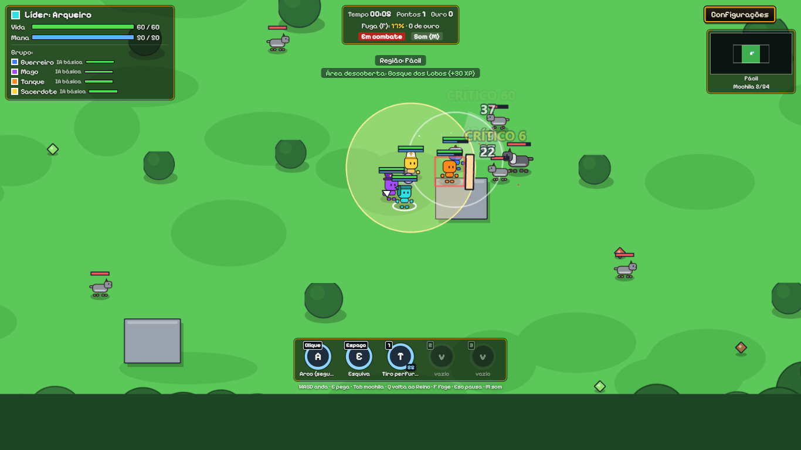
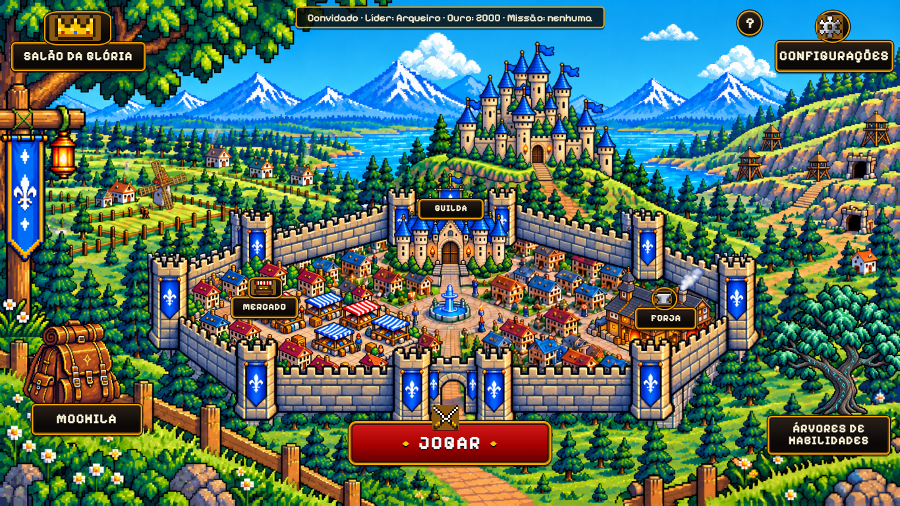

# Jogo RPG

**Um RPG de fantasia em pixel art, visto de cima, para jogar no navegador do computador.** Você monta um grupo de até 5 heróis (Guerreiro, Mago, Tanque, Sacerdote e Arqueiro), controla o Líder, explora a Floresta, derrota monstros e o chefe Ogro e volta ao Reino com o ouro para comprar, forjar e evoluir o grupo.

> O nome do jogo ainda vai ser escolhido pelo grupo; até lá, "Jogo RPG".

**▶ Jogar agora: [jogo-rpg-six.vercel.app](https://jogo-rpg-six.vercel.app)** (computador, teclado e mouse)

| A partida na Floresta | O Reino |
|---|---|
|  |  |

## Como jogar

- **Convidado ou conta:** na Tela inicial, clique em *Iniciar jogo*. Como convidado, o progresso fica só neste navegador. Com conta (e-mail, senha e apelido, com confirmação do e-mail), o progresso fica salvo no servidor e você aparece no ranking (Salão da Glória). A conta criada por um convidado leva o progresso dele.
- **O ciclo:** Reino → *Jogar* → Mapa → Floresta → Caravana (onde começar) → Preparação (Líder e mochila) → partida → Resumo (ouro, XP, itens) → Reino.

| Tecla | O que faz |
|---|---|
| W A S D | Andar |
| Mouse e clique | Mirar e atacar (o Arqueiro segura o clique para puxar o arco) |
| Espaço | Esquivar (só o Líder) |
| 1, 2, 3 | Habilidades |
| E | Pegar o item do chão; na mochila, usar no Líder (R: no aliado que mais precisa) |
| Tab | Abrir a mochila (o jogo não pausa) |
| Q | Voltar ao Reino (15 s fora de combate) |
| F | Fugir (5 s, mesmo em combate, pagando parte do ouro) |
| Esc | Fechar a janela; na partida, pausar |
| M | Ligar e desligar o som |

A Tela inicial tem o *Como jogar* completo, e toda tela tem um **?** que explica o que fazer nela.

## Equipe e disciplinas

- **Equipe:** Pablo Detoni, Lucas Garcia e Uener Peres.
- **Disciplinas:** Análise e Projeto de Sistemas (TI23L) e Desenvolvimento Web 2.
- **UTFPR**, câmpus Campo Mourão, 2026.

## Tecnologias

| Parte | Tecnologia |
|---|---|
| Interface (telas, menus, HUD) | [React](https://react.dev) com [Vite](https://vite.dev) |
| A partida (o mapa, os heróis e os monstros) | [Phaser 4](https://phaser.io), desenhado no canvas |
| Contas, saves na nuvem e ranking | [Supabase](https://supabase.com) (Postgres com RLS) |
| Site publicado | [Vercel](https://vercel.com) |
| Música e efeitos | Web Audio API do navegador (feitos em código, sem arquivos) |
| Testes | [Vitest](https://vitest.dev) (regras do jogo) e roteiros que jogam num navegador escondido |

## Onde está cada entrega

| Entrega | Onde |
|---|---|
| Conceito do jogo (PDF) | [documentacao/ideias/01_Conceito_do_Jogo.pdf](documentacao/ideias/01_Conceito_do_Jogo.pdf) |
| Diagrama de casos de uso | [documentacao/diagramas/02_Diagrama_Casos_de_Uso.png](documentacao/diagramas/02_Diagrama_Casos_de_Uso.png) |
| Diagramas de atividades | [Acesso](documentacao/diagramas/03_Diagrama_Atividades_Acesso.png), [Partida](documentacao/diagramas/04_Diagrama_Atividades_Partida.png), [Guilda](documentacao/diagramas/05_Diagrama_Atividades_Guilda.png) e [Caravana](documentacao/diagramas/06_Diagrama_Atividades_Caravana.png) |
| Protótipos (todas as telas, tema claro e escuro) | [documentacao/prototipos/](documentacao/prototipos/README.md) |
| Requisitos funcionais e não funcionais | [documentacao/docAdicional/08_Requisitos.md](documentacao/docAdicional/08_Requisitos.md) |
| Descrição dos casos de uso | [documentacao/docAdicional/06_Descricao_dos_Casos_de_Uso.md](documentacao/docAdicional/06_Descricao_dos_Casos_de_Uso.md) |
| Histórias de usuário | [documentacao/docAdicional/07_Historias_de_Usuario.md](documentacao/docAdicional/07_Historias_de_Usuario.md) |
| Matriz de rastreabilidade | [documentacao/docAdicional/09_Matriz_de_Rastreabilidade.md](documentacao/docAdicional/09_Matriz_de_Rastreabilidade.md) |
| Toda a documentação (índice) | [documentacao/README.md](documentacao/README.md) |
| O código | [programacao/](programacao/) (como ele está organizado: [Arquitetura do código](documentacao/Arquitetura_do_Codigo.md)) |

## Rodar no computador

Precisa do [Node.js](https://nodejs.org) **22.12 ou mais novo**.

```bash
cd programacao
npm install
npm run dev
```

Abra o endereço que aparecer (normalmente http://localhost:5173). Sem configurar nada, o jogo roda inteiro como convidado. Para as contas e o ranking, copie `programacao/.env.example` para `programacao/.env.local` e preencha com a URL e a chave **publicável** de um projeto do Supabase (o passo a passo, com os SQL, está em [documentacao/Supabase_passo_a_passo.md](documentacao/Supabase_passo_a_passo.md)):

```bash
VITE_SUPABASE_URL=https://<seu-projeto>.supabase.co
VITE_SUPABASE_PUBLISHABLE_KEY=sb_publishable_...
```

O `.env.local` nunca vai para o GitHub, e a chave secreta do Supabase nunca entra no jogo.

## Testes

Dentro de `programacao/`:

```bash
npm test             # as regras do jogo (Vitest)
npm run lint         # o padrão do código
npm run build        # monta o site
npm run testar:floresta   # um dos roteiros que jogam sozinhos num Edge escondido
```

Os outros roteiros (`testar:navegador`, `testar:reino`, `testar:camadas`, `testar:botoes`, `testar:som`, `testar:arte`, `testar:paredes`) estão no [package.json](programacao/package.json), e o registro de cada rodada fica em [testes/Registro.md](testes/Registro.md).
