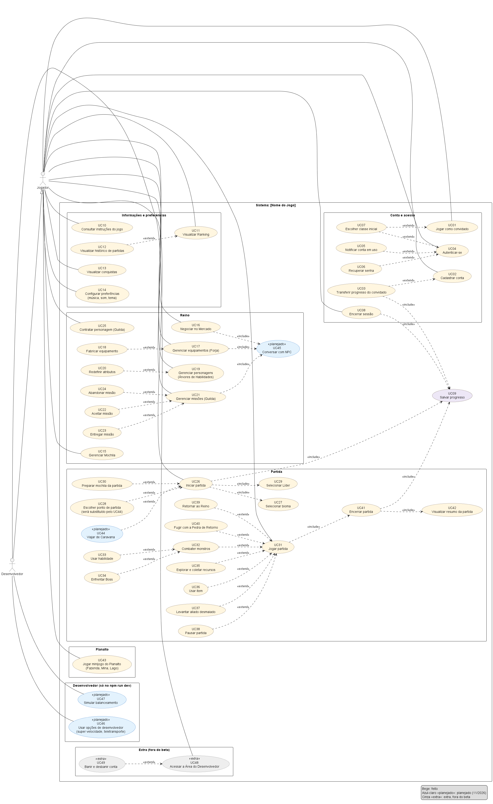

# RPG

**Tema:** RPG

**Alunos:** Pablo Detoni, Lucas Garcia e Uener Peres

Esta pasta reúne a documentação do projeto para Análise e Projeto de Sistemas (TI23L) e Desenvolvimento Web 2. Em caso de divergência, vale o conteúdo desta documentação. Atualizada em 27/11/2026 (Parte 13) pelo jogo publicado em https://jogo-rpg-six.vercel.app. A apresentação do projeto (como jogar, equipe, tecnologias e como rodar) está no [README da raiz](../README.md).

## Diagrama de Casos de Uso

## Arquivos

| Arquivo | Conteúdo |
|---|---|
| [Conceito do jogo (PDF)](ideias/01_Conceito_do_Jogo.pdf) ([Word](ideias/01_Conceito_do_Jogo.docx)) | Conceito completo do jogo e do beta (dezembro de 2026), com as alterações do projeto (seção 21) e os trabalhos futuros |
| [Diagrama de Casos de Uso (PNG)](diagramas/02_Diagrama_Casos_de_Uso.png) ([PlantUML](diagramas/02_Diagrama_Casos_de_Uso.puml)) | Os casos de uso, com «include» e «extend», os atores Jogador e Desenvolvedor e a Área do Desenvolvedor no pacote "Extra" |
| [Diagrama de Atividades: Acesso (PNG)](diagramas/03_Diagrama_Atividades_Acesso.png) ([PlantUML](diagramas/03_Diagrama_Atividades_Acesso.puml)) | Acesso ao jogo (convidado, cadastro, login, sessão única, passagem do progresso do convidado) |
| [Diagrama de Atividades: Partida (PNG)](diagramas/04_Diagrama_Atividades_Partida.png) ([PlantUML](diagramas/04_Diagrama_Atividades_Partida.puml)) | Mapa → Caravana → Preparação → partida → fim → Resumo |
| [Diagrama de Atividades: Guilda (PNG)](diagramas/05_Diagrama_Atividades_Guilda.png) ([PlantUML](diagramas/05_Diagrama_Atividades_Guilda.puml)) | A conversa com a Mestra Isolda, as missões e os contratos |
| [Diagrama de Atividades: Caravana (PNG)](diagramas/06_Diagrama_Atividades_Caravana.png) ([PlantUML](diagramas/06_Diagrama_Atividades_Caravana.puml)) | Escolher a parada, conferir o ouro, começar, cobrar no fim e não cobrar se a partida cair |
| [Protótipos](prototipos/README.md) | Prints de todas as telas do jogo (tema claro e escuro, 1366 × 768), com o caso de uso no nome; os protótipos iniciais em `prototipos/iniciais/` |
| [Descrição dos Casos de Uso](docAdicional/06_Descricao_dos_Casos_de_Uso.md) | Descrição de cada caso de uso, com relacionamentos e condições |
| [Histórias de Usuário](docAdicional/07_Historias_de_Usuario.md) | Uma história de usuário para cada caso de uso, com critérios de aceite |
| [Requisitos](docAdicional/08_Requisitos.md) | Requisitos funcionais e não funcionais, com a situação real de cada um |
| [Matriz de Rastreabilidade](docAdicional/09_Matriz_de_Rastreabilidade.md) | Cada requisito ligado ao caso de uso, à história, ao diagrama, ao protótipo e ao teste |
| [Balanceamento](Balanceamento.md) | Todos os números do jogo (XP, atributos, dano das classes, mobs por região, taxas, ouro, Caravana, simulador). Gerado pelo código: não edite à mão |
| [Arquitetura do código](Arquitetura_do_Codigo.md) | Onde fica cada parte do código e como elas conversam (React, Phaser, estado, regras puras, Supabase) |
| [Guia de interface](Guia_de_Interface.md) | O padrão visual das telas: cores e símbolos das ações, raridade pela cor da borda, tamanhos e estados |
| [Guia de arte](Guia_de_Arte.md) | A identidade visual e as decisões de arte do Pablo |
| [Lista de arte e som](Lista_de_Arte_e_Som.md) | O que precisa de arte e de som, com tamanhos e nomes de arquivo; as músicas e os efeitos feitos em código e onde cada um toca |
| [Supabase: passo a passo](Supabase_passo_a_passo.md) | Como criar o projeto no Supabase e rodar os SQL (001, 002, 004 e 005) |
| [Vercel: passo a passo](Vercel_passo_a_passo.md) | Como o site é publicado |

## Como regerar o que sai do código

Todos os comandos rodam dentro de `programacao/` (menos o PlantUML).

| O quê | Como |
|---|---|
| **Diagramas (PNG)** | Com o PlantUML (`plantuml.jar`, roda no Java): `java -jar plantuml.jar -charset UTF-8 diagramas/0X_....puml`. O PNG sai com o nome do `@startuml` (ex.: `Atividades_Caravana.png`): renomeie para o nome do arquivo (`06_Diagrama_Atividades_Caravana.png`). |
| **Protótipos (prints)** | `npm run prints -- prototipos` (tema claro, nesta pasta e o README da tabela) e `npm run prints -- prototipos escuro` (tema escuro, em `prototipos/escuro/`). Liga o jogo num Edge escondido e passa por todas as telas. |
| **Balanceamento.md** | `npm run balanceamento` (lê os números de `src/dados/` e roda o simulador). |
| **PDF do Conceito** | Pelo Word (PowerShell): `$w = New-Object -ComObject Word.Application; $d = $w.Documents.Open("<caminho>\01_Conceito_do_Jogo.docx", $false, $true); $d.ExportAsFixedFormat("<caminho>\01_Conceito_do_Jogo.pdf", 17); $d.Close(0); $w.Quit()`. Depois, abrir o PDF e conferir títulos, imagens e páginas. |

## Alterações do projeto

Durante a programação, algumas decisões mudaram ou completaram esta documentação. Os textos já estão atualizados, e cada documento termina com uma seção **Alterações do projeto** que lista o que mudou e por quê (a lista completa, com os motivos, está nos [Requisitos](docAdicional/08_Requisitos.md#alterações-do-projeto)). O Conceito do jogo tem a mesma seção no fim (seção 21).

## Números

49 casos de uso (47 do jogo e 2 extras) · 62 requisitos funcionais · 15 requisitos não funcionais · 49 histórias de usuário · 4 diagramas de atividades · 56 protótipos (cada um no tema claro e no escuro).

Os arquivos .puml podem ser abertos em qualquer editor de PlantUML (por exemplo, planttext.com) para editar os diagramas.
